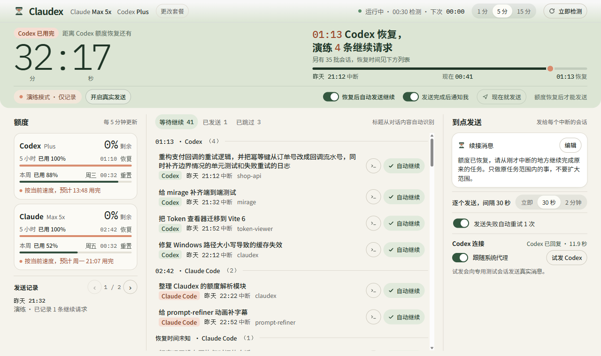
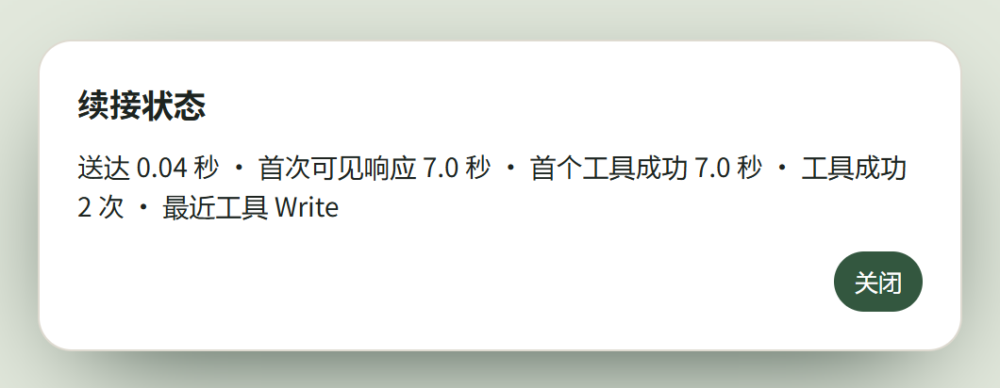

<p align="center"></p>
<h1 align="center">Claudex</h1>
<p align="center">在 Windows 上查看 Claude 和 Codex 的额度。额度恢复后，把「继续」发回刚才中断的原会话。</p>
<p align="center"><a href="https://github.com/kyoka-shuiyue/Claudex/releases/download/v0.3.3/Claudex-Windows-0.3.3.zip"><strong>下载 Windows x64 · v0.3.3</strong></a> · <a href="#开始使用">开始使用</a> · <a href="#怎样确认-claude-已经执行">查看执行回执</a> · <a href="https://github.com/kyoka-shuiyue/Claudex/releases/latest">发布说明与校验文件</a></p>



*演练界面示例。中间每一行对应一个原会话，可以单独选择「自动继续」或「跳过」。*

## 开始使用

1. **准备本机环境。** 安装 Ego Lite 并完成首次设置，它负责显示 Claudex 窗口。登录要使用的 Claude 桌面应用、Claude Code CLI 或本机 Codex。[下载 Ego Lite](https://lite.ego.app/)
2. **解压并启动。** 完整解压 Windows ZIP，双击 `安装Claudex.cmd`，再打开桌面快捷方式。便携使用可直接运行解压目录里的 `Claudex.exe`。发布包已附带 Node.js。
3. **先看一次演练。** 点「立即检测」，核对恢复时间、等待会话和右侧的续接消息。要接回 Claude 桌面会话，先点右下角「启用本地接入」，按提示重新打开目标会话。
4. **开启自动续接。** 确认要继续的会话，点「开启真实发送」，保持「恢复后自动发送继续」开启。以后只需让后台运行，关闭面板后仍会检测。

## 额度恢复后怎样续接


默认每 5 分钟检测一次。首次运行处于演练模式，发送记录里可以查看准备执行的命令。真实发送默认在恢复时间后留出 5 秒缓冲，保留原会话的上下文。尚待核对的投递会保留记录，避免重复发送。关闭自动发送会停下尚未开始的自动发送和自动重试。

## 怎样确认 Claude 已经执行

打开中间的「已发送」，点击 Claude 桌面会话那一行的状态。下面是一次真实文件任务的回执特写。

<p align="center"></p>

- **桌面已收信** 表示续接消息已进入原会话。若显示「仅有文字回复」，可以回到 Claude 查看回复内容。
- **等待工具回执** 表示 Claude 已请求调用工具。原会话若弹出权限确认，需要在 Claude 中处理。
- **工具已执行** 表示这轮请求已收到匹配的成功工具结果。点开可以看成功次数和最近使用的工具。要验收整项任务，再核对要求交付的文件或其他结果。

0.3.3 的读写测试先给专用 Claude 桌面会话留下一项待办，再分别通过「现在就发送」和到期自动发送触发续接。两次都只投递一条消息，输出文件各自与当次随机输入的 48 个字节完全一致。测试使用隔离队列模拟额度到期，消息、工具调用和文件读写均在本机实际发生。[查看 0.3.3 验收说明](https://github.com/kyoka-shuiyue/Claudex/releases/tag/v0.3.3)

## 接入与本机数据

- **Claude 桌面接入** 由 Claudex 安装。你确认后，它会先备份 Claude 的设置，再追加 `SessionStart` 钩子。新启动或恢复的会话沿用自己的登录、模型和权限。
- **Claude Code** 通过本机 CLI 续接原会话。精确的五小时和每周额度依赖可选的状态栏同步。
- **Codex** 优先读取本机账户接口，暂时无法读取时显示历史读数及其时间。「沿用原权限」会继承原会话最近一轮的沙箱模式，完全访问的会话也会沿用该模式。「试发 Codex」会向专用测试会话发送真实消息，演练模式下也一样。
- **本机数据** 保存在用户目录的 `.claudex`，包括配置、队列、日志和接入备份。界面服务监听 `127.0.0.1:4317`。要结束后台，运行安装目录里的 `停止Claudex.cmd`。默认安装目录为 `%LOCALAPPDATA%\Programs\Claudex`。

<details>
<summary>查看连接、代理和重试细节</summary>

桌面接入直接向原桌面进程投递消息。CLI 使用自己的登录与服务商配置，记录可能稍后才同步到桌面。CLI 两分钟内没有开始回复时会停止该次请求，已开始执行的长任务可以继续运行。系统代理可分别通过 `codex.useSystemProxy` 和 `claude.useSystemProxy` 控制。

会话从本机的 `.codex` 和 `.claude` 目录读取。Codex 账户读取使用 `account/read` 和 `account/rateLimits/read`，只保存套餐与额度等必要信息。若已有其他自动续跑任务，请选择一个发送入口以免重复投递。

</details>

## 从源码运行

使用 Node.js 22 或更高版本，在项目根目录运行以下命令。应用只依赖 Node.js 内置模块。

```sh
npm test
npm start
```

`npm start` 启动本地服务并打开 Ego 窗口。单次查看额度和会话可运行 `npm run scan`。

在 Windows PowerShell 中构建发布包时，将同时包含 `node.exe` 和 `LICENSE` 的 Node.js Windows 解压目录传给脚本。

```powershell
.\launch\build.ps1 -NodeDirectory C:\tools\node-v22.22.3-win-x64
```

构建产物在 `dist/`。Claudex 源码采用 MIT 许可证，字体及所附 Node.js 沿用各自的许可证。[MIT 许可证](./LICENSE) · [第三方许可](./THIRD_PARTY_NOTICES.md)

